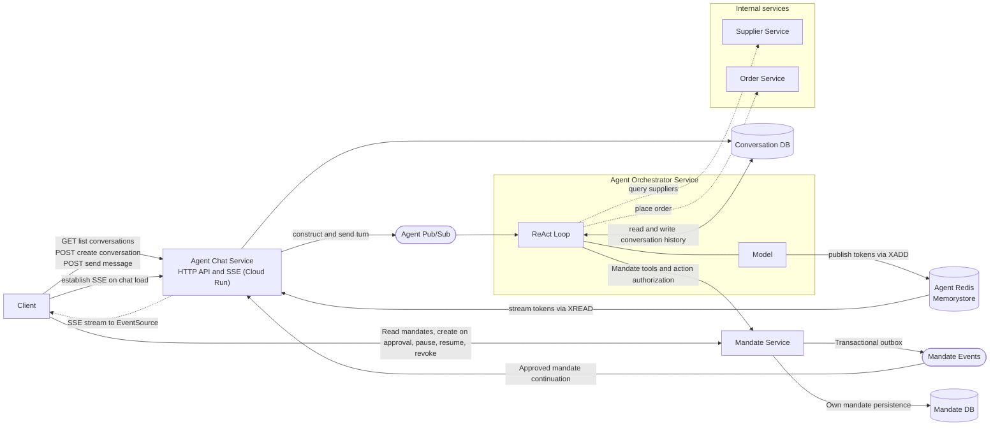
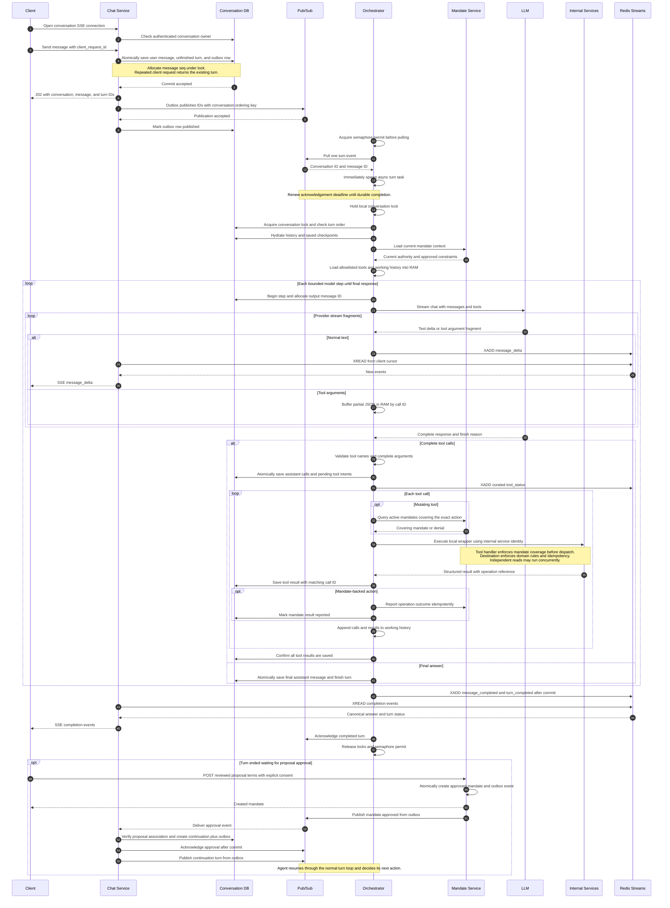
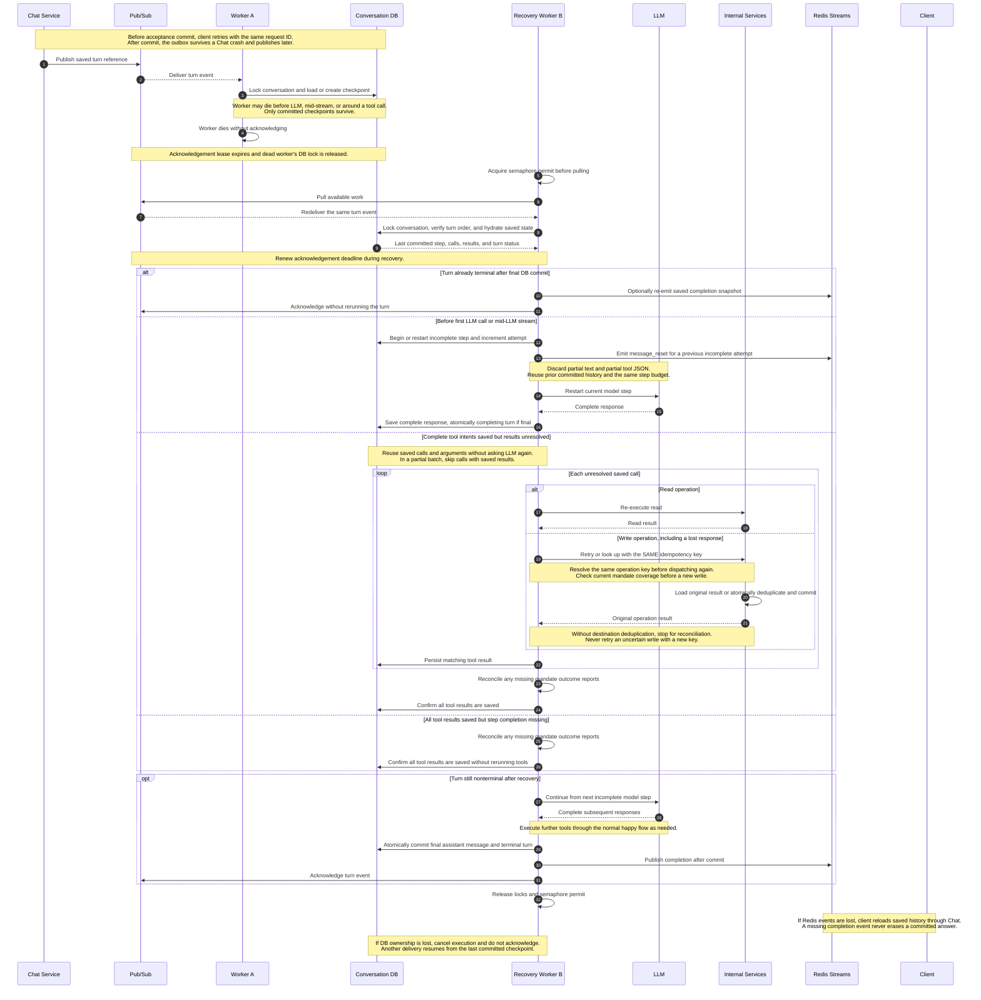
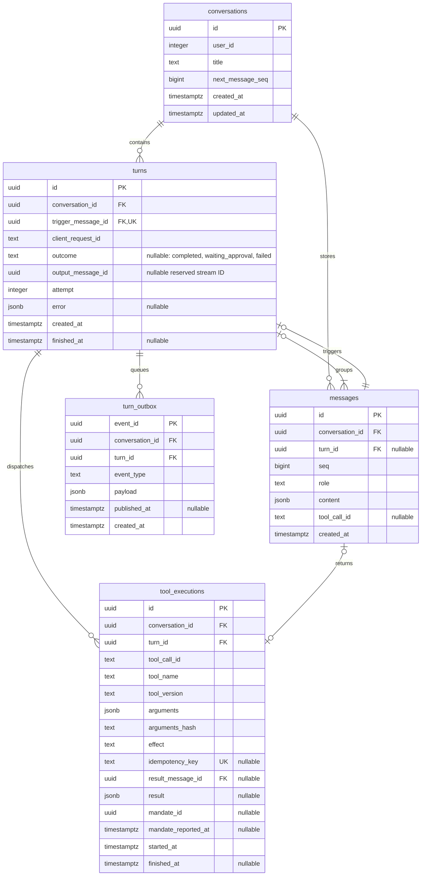
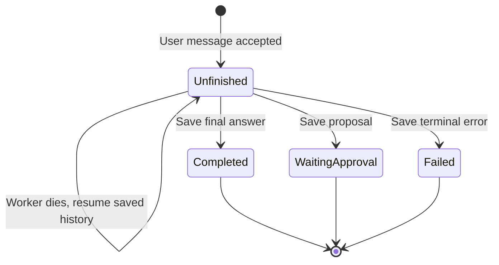
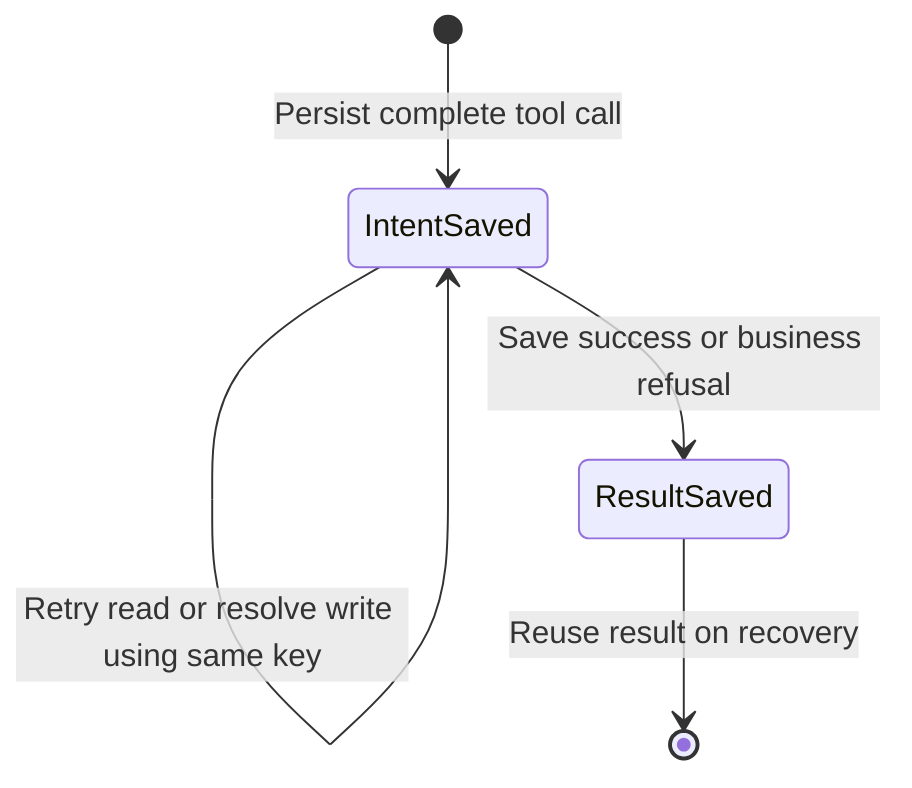
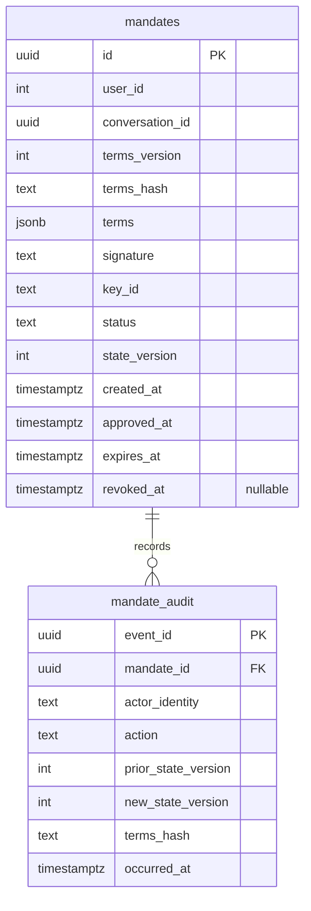

# Agent chat and orchestrator redesign technical design

Status: Historical design, superseded by [the current implementation guide](agent-skeleton-implementation.md). Date: 9 November 2026.

The current skeleton uses whole-turn retries, pending mandate approval by ID, and static supplier and amount constraints.
The checkpoint recovery, signing, action restrictions, and accounting sections below describe the earlier design.

This design defines the conversation-driven agent architecture, service boundaries, execution contracts, and recovery behaviour.

## 1. Architecture and execution design

### 1.1 Architecture diagram

The ReAct loop and model adapter run inside Orchestrator. Chat Service handles HTTP and SSE delivery. Mandate Service owns mandate policy and persistence.



Orchestrator publishes events with Redis Streams `XADD`. Chat reads them with `XREAD`, using an independent cursor for each SSE client.

### 1.2 Deployment boundaries

| Domain | Deployment or managed resource | Platform | Includes |
| --- | --- | --- | --- |
| Agent | Agent Chat Service | Cloud Run | Conversation HTTP API, SSE delivery, approval-event handler, and turn outbox publication |
| Agent | Agent Orchestrator Service | Cloud Run | Pull consumer, ReAct loop, model adapter, Tool Registry, tool handlers, and service clients |
| Agent | Conversation DB | Cloud SQL for PostgreSQL | Shared conversation database for Chat and Orchestrator, with separate database roles |
| Agent | Agent Pub/Sub | Google Cloud Pub/Sub | Turn topic and Orchestrator pull subscription |
| Agent | Agent Redis | Memorystore for Redis | Temporary Redis Streams for SSE delivery |
| Mandate | Mandate Service | Cloud Run | User-facing mandate API, internal coverage queries, signing, lifecycle, and approval outbox publication |
| Mandate | Mandate DB | Cloud SQL for PostgreSQL | Mandate-owned database, accessible only by Mandate Service |
| Mandate | Mandate Events | Google Cloud Pub/Sub | Approval events and Chat subscription |
| Supplier | Supplier Service | Cloud Run | Supplier API and domain logic |
| Order | Order Service | Cloud Run | Order API, domain logic, and write idempotency |

Key technical details:

- Turn references use at-least-once delivery, ordered by conversation ID. Acknowledge only after durable turn completion or a saved approval wait.
- Orchestrator and Tool Registry run in the same process, with CPU available for continuous queue pulling.

### 1.3 Happy flow



A proposal requiring mandate approval ends the turn with `waiting_approval`, a saved proposal, and a `mandate_proposed` event. This is a durable stop, so the queue delivery can be acknowledged. Mandate Service commits approval and its `mandate.approved` outbox event atomically. Chat consumes the event and creates a continuation turn through its own outbox. No worker or queue delivery waits for a human response.

### 1.4 Concurrency, ordering, and acknowledgement

Pub/Sub uses `conversation_id` as the ordering key. Enable message ordering on the pull subscription and publish a conversation's events through one ordered publisher path in one region. The outbox publisher serializes publication by the triggering user message's `seq` for each conversation, including when several publisher instances run. Pub/Sub preserves publication order, not the database's turn order. See [Pub/Sub message ordering](https://docs.cloud.google.com/pubsub/docs/ordering).

The local lock prevents concurrent tasks in one worker. A PostgreSQL session advisory lock, keyed by conversation ID, serializes workers and duplicate deliveries across processes. Use a dedicated connection while holding that lock, but keep transactions short and never hold an open transaction over a model or service call. A lock connection failure cancels the active task and prevents further checkpoint writes. A stale task's already-issued write remains safe through downstream idempotency.

The database turn-order check is still required. A lock serializes access but does not select which waiting turn executes next. If an earlier turn is nonterminal, defer the later delivery with bounded retry and leave its turn queued. Dead-lettering an earlier turn does not silently let later turns pass it; the recovery process must first mark it terminal or requeue it.

Concurrency pseudocode:

```python
sem = asyncio.Semaphore(50)
tasks = set()

async def consumer():
	while not stopping:
		await sem.acquire()  # bound pulls and live tasks, not just LLM calls
		try:
			msg = await queue.pull_one()  # SDK buffering is bounded too
			task = asyncio.create_task(handle_turn(msg))
			tasks.add(task)
			task.add_done_callback(tasks.discard)
		except BaseException:
			sem.release()
			raise

async def handle_turn(msg):
	try:
		async with queue.renew_ack_deadline(msg):
			async with local_locks.hold(msg.conversation_id):
				async with db.conversation_lock(msg.conversation_id):
					await run_or_resume_turn(msg)
			await queue.ack(msg)  # only after durable terminal state
	except RetryableError:
		await queue.retry_with_backoff(msg)
	except asyncio.CancelledError:
		raise  # no ack; broker redelivers
	except Exception as error:
		await record_and_defer(msg, error)  # never swallow a task failure
	finally:
		sem.release()
```

Remove a local lock entry only when no holder or waiter remains. The initial concurrency limit is configurable and starts at 50 deliveries per worker. Apply provider, database-connection, and per-user limits as separate bounds.

Extend acknowledgement deadlines while processing, including time spent waiting for locks. Configure SDK lease limits to exceed the bounded turn deadline. Stop accepting work during shutdown, finish within the grace period, and cancel remaining tasks without acknowledgement. Pub/Sub can redeliver messages, so correctness never depends on a delivery occurring once. See [Pub/Sub subscription overview](https://docs.cloud.google.com/pubsub/docs/subscription-overview).

### 1.5 Turn loop and checkpoint rules

Later user messages may be accepted while a turn runs. Hydration includes completed prior turns, system context, the triggering user message, and this turn's committed checkpoints. It excludes later queued user messages. Physical message `seq` order alone does not define the LLM context boundary.

```python
messages, tools = await hydrate(turn)
while await within_turn_limits(turn):
	calls = await load_unresolved_calls(turn)
	if not calls:
		attempt = await begin_stream_attempt(turn)
		response = await consume_llm_stream(messages, tools, attempt)
		if response.is_final:
			await finish_turn_and_publish_snapshot(turn, response)
			return
		await persist_assistant_calls_and_intents(turn, response)
		calls = response.calls
	for call in calls:
		result = await execute_or_load_saved_result(call)
		await persist_tool_result(call, result)
	await reconcile_missing_mandate_reports(turn)
	messages = await load_committed_turn_context(turn)
await fail_turn(turn, code="TURN_LIMIT")
```

Persist the final response and turn completion in one transaction. `finish_turn_and_publish_snapshot` commits the database first; Redis publication is a best-effort notification and cannot roll back a completed turn.

Use explicit step, tool-count, token, argument-size, output-size, service-timeout, and total-turn limits. Proposed starting limits are 8 model steps, 16 tool calls, and a 120-second turn deadline, all configurable. A limit ends the turn with a durable failure or clarification outcome. A retry reuses the existing step budget.

### 1.6 Sad flow: worker dies



"Tool call persisted" has two meanings. A persisted intent permits dispatch or retry. A persisted result permits moving to the next step. Recording a start alone never proves that the external operation completed.

Turn ID alone is too broad for mutation deduplication. Use a stable key such as `turn_id:tool_call_id:operation`. The destination stores the key, canonical request hash, status, and original response in its own database. A repeated key with different arguments is a conflict. Deduplication and the domain write commit atomically. If the destination delegates another write, it propagates a stable operation identity or uses its own transactional outbox.

Order and every other mutating destination must implement this contract. If a destination cannot provide it, an uncertain write stops for reconciliation rather than being blindly replayed. Retrying an entire turn with a new ID is never a recovery strategy.

### 1.7 Conversation database schema

The following is the logical PostgreSQL schema. UUIDs are proposed persisted IDs; names such as `conv_456` in examples are readable aliases. User IDs retain the existing integer identity. Timestamps use UTC. Service-owned schemas have no cross-service foreign keys.

One conversation contains turns and messages. Each turn runs model steps; each step can produce tool calls. The outbox delivers accepted turns to the worker queue.



Constraints and indexes, in addition to the primary keys shown above:

```sql
ALTER TABLE conversations ADD CHECK (next_message_seq >= 1);
CREATE INDEX conversations_owner ON conversations (user_id, updated_at);

ALTER TABLE turns
	ADD UNIQUE (conversation_id, id),
	ADD UNIQUE (conversation_id, client_request_id),
	ADD UNIQUE (trigger_message_id),
	ADD FOREIGN KEY (conversation_id) REFERENCES conversations (id),
	ADD CHECK (attempt >= 0),
	ADD CHECK ((finished_at IS NULL AND outcome IS NULL) OR
		(finished_at IS NOT NULL AND outcome IS NOT NULL AND
		 outcome IN ('completed', 'waiting_approval', 'failed')));

ALTER TABLE messages
	ADD UNIQUE (conversation_id, id),
	ADD UNIQUE (conversation_id, seq),
	ADD FOREIGN KEY (conversation_id) REFERENCES conversations (id),
	ADD FOREIGN KEY (conversation_id, turn_id)
		REFERENCES turns (conversation_id, id),
	ADD CHECK (role IN ('system', 'user', 'assistant', 'tool')),
	ADD CHECK (role <> 'tool' OR tool_call_id IS NOT NULL);
ALTER TABLE turns ADD FOREIGN KEY (conversation_id, trigger_message_id)
	REFERENCES messages (conversation_id, id) DEFERRABLE INITIALLY DEFERRED;
CREATE UNIQUE INDEX messages_tool_result
	ON messages (conversation_id, turn_id, tool_call_id) WHERE role = 'tool';
CREATE INDEX messages_turn_history ON messages (conversation_id, turn_id, seq);

ALTER TABLE tool_executions
	ADD UNIQUE (turn_id, tool_call_id),
	ADD UNIQUE (idempotency_key),
	ADD FOREIGN KEY (conversation_id, turn_id)
		REFERENCES turns (conversation_id, id),
	ADD FOREIGN KEY (conversation_id, result_message_id)
		REFERENCES messages (conversation_id, id),
	ADD CHECK (effect <> 'write' OR idempotency_key IS NOT NULL);
ALTER TABLE turn_outbox
	ADD UNIQUE (turn_id, event_type),
	ADD FOREIGN KEY (conversation_id, turn_id)
		REFERENCES turns (conversation_id, id);
CREATE INDEX turn_outbox_unpublished ON turn_outbox (created_at)
	WHERE published_at IS NULL;
```

| Enforcement layer | Rule |
| --- | --- |
| Database | Primary/unique keys prevent duplicates; composite foreign keys enforce conversation membership; checks validate roles and turn completion fields |
| Service transaction | Saves tool results with their messages, and final answers with turn completion, atomically |
| Worker | Holds the conversation lock, runs unfinished turns in triggering-message `seq` order, and resumes unresolved calls with saved operation keys |

Only turns have a saved completion outcome. Tool progress is derived from whether a result exists. These diagrams show recovery decisions, not additional stored status fields.



Approval creates a new continuation turn; it does not reopen the finished proposal turn.



A missing result never proves that a write failed. Resolve it through destination idempotency before proceeding. Model steps have no separate database row or state; saved assistant calls and tool results define the checkpoint. A turn's stream ID and attempt identify provisional output. After a complete response, clear the reserved stream ID in the same transaction; the next invocation allocates a new ID. Persist partial tokens only in Redis.

Example message:

```json
{
	"id": "msg_004",
	"conversation_id": "conv_456",
	"turn_id": "turn_002",
	"seq": 4,
	"role": "assistant",
	"content": {
		"text": "I will check the approved suppliers.",
		"tool_calls": [
			{"id": "call_01", "name": "search_suppliers", "arguments": {"query": "coffee"}}
		]
	}
}
```

A tool result uses role `tool`, the same `tool_call_id`, and structured result content. Credentials, raw provider reasoning, and partial tool JSON are never message content. System messages are created by trusted server code only.

### 1.8 Mandate and destination database contracts

Mandate Service retains its separate storage boundary:



`conversation_id` is an external reference, not a cross-database foreign key. Approved terms, their version and hash, and audit events are immutable. Lifecycle transitions increment `state_version` and preserve prior and new versions in the audit.

A proposal is saved as structured conversation data, not as an approved mandate. The trusted UI displays the proposed terms. When the user approves, the client posts those exact terms, their hash, and the proposal reference directly to Mandate Service. Mandate Service authenticates the owner, validates the terms, creates the approved mandate, and saves consent evidence and its approval event atomically. A unique approval request ID makes retries return the same mandate. Changes to approved terms require new consent and a new mandate. Lifecycle changes preserve the original terms.

Each mutating destination has `operation_dedup(service_principal, idempotency_key, request_hash, state, response_json, resource_id, created_at)`, unique on `(service_principal, idempotency_key)`. Its retention covers the entire retry and reconciliation horizon. External references are opaque IDs, not cross-database foreign keys.

### 1.9 Queue and client event schemas

The queue event contains only the lookup IDs in its body. `turn_id` and user identity are loaded from the accepted message and its turn. Message text is already in Conversation DB and is not duplicated on the queue.

```json
{
	"conversation_id": "conv_456",
	"message_id": "msg_101"
}
```

Pub/Sub metadata contains `ordering_key = conv_456` and attributes `event_type = agent.turn.requested`, `schema_version = 1`, `event_id`, and optional `traceparent`. The broker delivery ID is transport metadata, not the turn's idempotency key. Validate IDs, event version, conversation membership, and the triggering message role before hydration. Queue content cannot override the owner loaded from the database.

Redis key: `agent:conversation:{conversation_id}:events`. `XADD` stores a `type` field and a serialized `data` envelope. The Redis entry ID becomes the SSE `id`. Each envelope includes `schema_version`, `event_id`, `conversation_id`, `turn_id`, `attempt`, and `occurred_at`. Events about assistant text also include `message_id`. Allocate `turns.output_message_id` before publishing deltas. Reuse it when retrying an incomplete stream and increment the saved attempt. Save the complete message using that ID.

| Event type | Additional data | Client behaviour |
| --- | --- | --- |
| `message_started` | `message_id` | Create a provisional assistant response |
| `message_delta` | `message_id`, `text` | Append text within this attempt |
| `message_reset` | `message_id`, `reason` | Discard the previous incomplete attempt for this step |
| `tool_status` | `tool_call_id`, `tool_name`, `status`, `display_text` | Show a curated indicator such as "Checking suppliers" |
| `mandate_proposed` | `proposal_id`, `terms_hash`, `constraints`, `expires_at` | Render a review card; approval still requires a user-authenticated request |
| `message_completed` | `message_id`, `status`, `text` | Replace provisional text with the canonical saved answer |
| `turn_completed` | `status`, `last_message_seq` | Mark this turn complete or waiting for approval |
| `turn_failed` | `code`, `display_text`, `last_message_seq` | Show a saved failure without exposing internal exceptions |
| `resync_required` | `reason` | Reload durable history and turn state through Chat |

Example SSE frame:

```text
id: 1794186000000-0
event: message_delta
data: {"schema_version":1,"event_id":"evt_201","conversation_id":"conv_456","turn_id":"turn_123","attempt":1,"message_id":"msg_102","occurred_at":"2026-11-09T01:00:00Z","text":"Here is the report you requested."}

```

Example mandate event data, with the common envelope omitted for readability:

```json
{
	"proposal_id": "proposal_123",
	"terms_hash": "sha256:...",
	"constraints": {
		"recurrence": {"frequency": "daily", "local_time": "09:00", "timezone": "Asia/Singapore"},
		"overall_credit_cap": 100,
		"per_occurrence_credit_cap": 10,
		"allowed_supplier_ids": ["supplier_42"],
		"allowed_actions": ["order.create"]
	},
	"expires_at": "2026-11-30T15:59:59Z"
}
```

Required mandate terms depend on the enabled tool and policy. Approval cards display the saved proposal, its exact terms hash, and supplier names alongside IDs. An approved mandate ID exists only after Mandate Service accepts user consent.

Retries increment the step attempt and emit `message_reset` before new deltas. The client ignores older attempts and deduplicates event IDs. Saved tool statuses and final snapshots can be re-emitted after a crash. Redis deltas are provisional and can be lost; durable messages are canonical.

### 1.10 Tool interface and service wrappers

The registry contains a definition and a local handler for each tool:

```text
ToolDefinition
	name, version, description
	input_schema, output_schema
	effect: read | write
	required_action: optional mandate action

ToolContext  # trusted server values, never model arguments
	user_id, conversation_id, turn_id, tool_call_id
	idempotency_key, mandate_id, cancellation_signal, deadline, trace_id

ToolHandler.execute(validated_arguments, context) -> ToolResult

ToolResult
	ok: boolean
	data: bounded JSON on success
	error: {code, message, retryable} on failure
	resource_id: optional destination reference
```

`ToolResult` is a success/error union in the implementation. Parse untrusted model arguments once at the dispatcher boundary. The dispatcher rejects unknown names, unsupported versions, malformed input, and excess argument size. Handlers return bounded structured results. Sanitise error messages before sending them to the model or SSE.

| Tool | Model input | Local handler and downstream call |
| --- | --- | --- |
| `search_suppliers` | Query and supported filters | Supplier adapter calls internal catalog search and bounds results |
| `get_order` | Order ID | Order adapter checks access through the destination and returns current state |
| `propose_mandate` | Proposed tasks and constraints | Returns structured proposal data for persistence in conversation history and display in the trusted UI; creates no mandate |
| `get_mandate` | Mandate ID | Mandate wrapper retrieves authoritative terms and lifecycle status after owner and scope checks |
| `place_order` | Order choices | Handler queries Mandate Service for an active mandate covering the exact action; Order adapter creates the order with a stable key |
| `cancel_order` | Known Order ID | Handler queries Mandate Service for coverage of the exact cancellation; Order adapter validates the order lifecycle and deduplicates the command |

`propose_mandate` returns a proposal for the trusted UI. It does not create or approve a mandate. `get_mandate` wraps Mandate Service to retrieve existing authorization. User approval is not a model-visible tool; the client submits consent directly to Mandate Service, which creates the mandate.

Mutation handlers such as `place_order` and `cancel_order` must query Mandate Service for active mandates covering the authenticated user and exact proposed action. The check includes validity, lifecycle, permitted actions, suppliers, amounts, and other approved constraints. Without covering authority, the handler refuses the action and returns a tool result. The model cannot skip this check. Order trusts the authenticated Orchestrator to enforce mandate coverage and independently enforces its own domain rules and idempotency.

A handler wraps a domain API, not arbitrary HTTP. The LLM cannot supply a hostname, bearer token, user ID, authorization header, SQL, or service path. Derive identity from the turn and load fixed constraints from the approved mandate. A mandate ID supplied by the model is merely a reference whose owner and scope must be checked.

The execution sequence for a write is:

1. Persist the complete tool intent, validated arguments, and idempotency key.
2. Query Mandate Service for an active mandate covering the exact action and authenticated owner. Save the covering mandate ID with the tool execution. Refuse dispatch if no mandate covers the action.
3. Call the destination's internal API with authenticated service identity, user identity, and the stable operation key.
4. The destination checks the caller, requester/resource binding, domain rules, and idempotency before committing. It does not call Mandate Service.
5. Persist the result and report its operation reference to Mandate idempotently where needed to update action history. Track `mandate_reported_at` and retry missing reports before completing the step.

Coverage is checked immediately before a new mutation. An already-dispatched operation may finish after a mandate is revoked. Resolving the outcome of a prior operation uses its original idempotency key and does not create fresh authority.

Normal business denials become tool results, allowing the model to adjust its proposal. Authentication failures stop dispatch. Unknown mutation outcomes remain unresolved until the destination's key lookup or reconciliation establishes the result.

### 1.11 Proposed module folders

Chat HTTP routes and SSE delivery share one deployment and route module. Orchestrator workers and Mandate Service remain independently deployable and scalable.

```text
agent-service/
  contracts/                 # conversation, event, mandate, and tool types
  db/                        # shared client factory, schema, config, migrations
  chat/src/
    main.ts
    controller.ts
    services.ts              # accept messages and create continuation turns
    repository.ts            # conversation queries and acceptance transactions
    outbox.ts                # ordered Pub/Sub publication
    handlers/
      routes.ts              # HTTP and SSE lifecycle/replay/heartbeat
      eventHandlers.ts       # mandate approval consumption
  orchestrator/src/
    main.ts
    config.ts
    services.ts              # hydration, turn loop, ordering, recovery
    repository.ts            # checkpoints, intents, saved results
    eventPublisher.ts        # curated Redis events
    handlers/eventHandlers.ts # pull consumer, semaphore, lease, shutdown
    common/locks.ts          # local/session locks, cancellation, fencing
    clients/                 # model, supplier, order, mandate, transport
    tools/                   # registry, dispatcher, domain handlers
mandate-service/
  migrations/
  src/
    main.ts
    controller.ts
    services.ts              # approval, lifecycle, accounting workflows
    repository.ts            # mandates, ledger, consent audit
    outbox.ts                # approval publication
    handlers/
      routes.ts              # owner and internal HTTP APIs
      eventHandlers.ts       # trusted domain evidence
    clients/chat.ts          # proposal evidence
    common/                  # local input types, coverage, signing
    db/                      # mandate-owned client and schema
```

Mandate tools live under Orchestrator `tools/` and use its Mandate HTTP client. Mandate business logic and its database schema live only in `mandate-service/`.

Share contracts and the database factory, not business services or a universal repository layer. Conversation schema and migrations have one owner under `agent-service/db`; deploy migrations once before dependent processes start. Each process creates its own pool with restricted credentials and keeps its own queries. Local `common/` modules hold reusable methods and types, without depending on HTTP handlers.

## 2. HTTP and internal service contracts

### 2.1 Client routes

| Service and route | Contract |
| --- | --- |
| `GET /conversations` | List the authenticated owner's conversations with cursor pagination |
| `POST /conversations` | Create an owner-scoped conversation |
| `GET /conversations/{id}/messages` | Return saved messages, active turn state, and a stable pagination cursor |
| `POST /conversations/{id}/messages` | Accept `{client_request_id, text}` and return `202 {conversation_id, message_id, turn_id}` |
| Mandate: `GET /mandates` | List the authenticated owner's mandates |
| Mandate: `GET /mandates/{id}` | Return authoritative terms and lifecycle state |
| Mandate: `POST /mandates` | Create an approved mandate from `{approval_request_id, proposal_id, conversation_id, origin_turn_id, terms, terms_hash}` with explicit user consent |
| Mandate: `POST /mandates/{id}/pause`, `/resume`, `/revoke` | Apply owner-authorized lifecycle changes with expected state version |
| `GET /conversations/{id}/events` | Authenticate owner, resume from `Last-Event-ID`, and emit SSE frames |

Conversation and SSE routes belong to Chat. Mandate routes belong to Mandate Service and authenticate the user directly, checking authenticated ownership, proposal association, and the exact reviewed terms. Service credentials cannot replace user consent. Configure the frontend proxy or CORS for these routes and protect cookie-authenticated mutations against CSRF.

Approval and continuation use an event contract rather than a browser callback. Mandate creates the approved mandate and a `mandate.approved` event in one transaction. The event contains `event_id`, `schema_version`, `approval_id`, `mandate_id`, `terms_version`, `terms_hash`, `user_id`, `conversation_id`, `origin_turn_id`, and `occurred_at`. Its publisher retries until broker acceptance.

Chat consumes approved events through an authenticated durable subscription. It verifies the owner, proposal-to-conversation association, and originating turn with outcome `waiting_approval`, then atomically creates a continuation turn and turn outbox row. A unique continuation request ID derived from `approval_id` deduplicates event redelivery. Chat acknowledges the approval event only after commit. A crash between the two service commits is recovered through outbox publication and event redelivery. Approval succeeds independently of continuation latency; execution progress is available through Chat history and SSE.

Native browser EventSource cannot set an arbitrary bearer header. Use the same-origin secure session cookie through the frontend proxy, or issue a short-lived scoped stream credential. Do not put a long-lived user JWT in a URL. Protect cookie-authenticated mutations against CSRF.

### 2.2 Internal routes

These contracts replace the assumption that Agent must call public APIs with an interactive user JWT:

| Destination | Proposed internal capability |
| --- | --- |
| Supplier | Search and retrieve authorized catalog data |
| Order | Create, inspect, and cancel orders for an authorized requester; operation lookup by idempotency key |
| Mandate | Read authoritative context, find active mandates covering an exact action, and report operation outcomes; approved creation and lifecycle routes require explicit user authority |

Use a common internal header contract: service identity token in `Authorization`, `Idempotency-Key` for writes, and `traceparent` for tracing. User and mandate references are explicit request fields and validated against trusted records. Each destination defines and validates its own request schema. Transport errors, domain refusals, and uncertain writes have distinct typed responses.

## 3. Service authorization and infrastructure

### 3.1 Access matrix

| Principal | Required permissions | Boundary |
| --- | --- | --- |
| Chat | Conversation acceptance/read role, publish turn topic, read conversation Redis streams, consume mandate approval subscription | Cannot approve mandates, consume turn work, or execute tools |
| Orchestrator | Consume turn subscription, execution DB role, write conversation Redis streams, invoke allowlisted internal service routes, read LLM secret | Cannot approve/widen mandates or access signing keys |
| Mandate | Own database, signing secret, trusted domain evidence, publish mandate events | Agent credentials alone never grant owner consent |
| Order | Own database, emit ordinary domain events | Enforces lifecycle and requester binding independently |
| Supplier | Own database and internal read policy | Catalog access does not grant order authority |

Use a dedicated runtime service account per deployable. Production service calls use short-lived identity tokens with the destination audience, a verified issuer, and an explicit invoker allowlist. Network reachability is not authorization. Map internal methods to allowed service principals rather than granting every internal caller every action.

Limit Pub/Sub IAM to topic publisher or subscription subscriber as appropriate. Give Redis private-network access, supported authentication and TLS, and scoped credentials where available. If the selected Redis deployment cannot enforce per-key read/write roles, document that coarser trust boundary and isolate it from unrelated workloads. Keep signing keys exclusively in Mandate and LLM secrets exclusively in Orchestrator.

Configure the Orchestrator Cloud Run deployment for continuous pull consumption with CPU available outside HTTP requests. A request-scoped HTTP handler is not the owner of a detached turn task. Deploy Chat, including its SSE routes, on Cloud Run with connection timeouts and reconnection configured explicitly.

### 3.2 SSE replay and persistence boundaries

Use bounded `XREAD BLOCK`, heartbeats, disconnect cancellation, and per-client output limits. Retain Redis streams for a configured time and entry budget. Reconnect with the last Redis entry ID rather than `$`, which would skip retained events. On first load, subscribe from a captured stream cursor before fetching history, buffer incoming events during the fetch, and deduplicate them against the saved snapshot.

If a cursor is trimmed, invalid, or lost during Redis failover, emit `resync_required` and reload Conversation DB. Resume live reads from the captured current cursor and discard events already represented by the snapshot. On reconnect, reload durable turn state even if no completion event is present. A completed turn remains discoverable if its worker died before `XADD`.

A slow client may lose provisional deltas and resync. It must never slow the durable turn loop indefinitely. Apply short bounded Redis publication retries. A lost final notification is recoverable from saved messages, so this design does not need a second durable outbox for every text token.

### 3.3 Combined Chat and SSE capacity

SSE is asynchronous I/O in Chat; model inference and tool execution remain in Orchestrator. Chat reuses its authentication and ownership checks for the stream endpoint. There is no separate SSE deployment or service account.

Open SSE requests consume Cloud Run request concurrency for their lifetime. Configure concurrency, instance limits, and resources for both persistent connections and short API requests. Cloud Run supports up to 1,000 concurrent requests per instance, but the application must be load-tested before selecting its limit. See [Cloud Run limits](https://docs.cloud.google.com/run/quotas).

Keep blocking Redis reads on dedicated connections, separate from ordinary Redis commands. Bound the reader connection count and reuse a conversation reader for local subscribers when needed. Each client retains an independent replay cursor and bounded output buffer. Disconnect slow consumers so they can replay or resync rather than consume unbounded memory.

Cloud Run request timeouts require periodic reconnection; the maximum is 60 minutes. Deployments can also interrupt streams. Reconnect with backoff and jitter, resume from the saved cursor, and reload durable turn state. See [Cloud Run streaming guidance](https://docs.cloud.google.com/run/docs/triggering/websockets).

Measure open streams, Redis connections, event-loop delay, buffered bytes, and ordinary API latency under concurrent message submission and streaming. Consider a separate SSE deployment only if measured contention or different scaling needs justify it. Keep the streaming module separate so extraction does not change queue or client event contracts.

### 3.4 Operations and failure classification

Log conversation, turn, step, attempt, tool call, operation key, and trace IDs. Record queue age, active permits, lock wait, time to first token, model latency, tool latency, retries, uncertain mutations, Redis failures, and dead-letter count. Exclude credentials and redact sensitive arguments.

Retry transient model failures only before the model response checkpoint or from the last saved checkpoint. Retry service writes only with their saved operation key. Use backoff and bounded attempts. Persist a safe terminal error for invalid accepted work or exhausted turn limits. Quarantine malformed transport events without trusting their claimed conversation identity. Alert on dead letters and reconcile their database turns so one conversation does not remain blocked indefinitely.

Recurrence scheduling, notifications outside the open conversation, and the existing Order/Credit Saga remain separate concerns. A future scheduler can create durable continuation turns through the same acceptance/outbox contract. It does not bypass conversation ordering or mandate authorization.

## 4. Review and acceptance criteria

Acceptance criteria:

- Two workers receiving the same turn produce one saved answer and one instance of each external mutation.
- Different conversations run concurrently; turns in one conversation execute in accepted the triggering user message's `seq` order.
- Killing a worker mid-stream restarts only the incomplete step and replaces provisional output.
- Killing a worker after an Order commit but before its response is saved returns the original Order on retry with the same key.
- A partially completed tool batch resumes unresolved calls with saved arguments and existing results.
- No external mutation occurs before its intent is persisted and its exact mandate action is authorized.
- Mandate tools wrap Mandate Service; the model cannot approve a proposal or skip authorization inside mutation handlers.
- Changed arguments with a reused operation key are rejected by the destination.
- Concurrent SSE connections do not exhaust Redis connections or cause unacceptable Chat API latency at the agreed load.
- Closing the browser leaves the turn running; reconnect recovers saved history and live progress.
- Redis failure cannot erase a completed answer or make partial tool JSON executable.
- Expired, revoked, wrong-owner, or out-of-scope mandates cannot authorize new actions.
- Direct client approval and lifecycle calls enforce user ownership and exact terms.
- Approval event redelivery and crashes create at most one continuation turn without relying on a browser callback.
- Semaphore saturation bounds pulled deliveries and live tasks, including lock waiters.
- A terminal commit followed by a lost acknowledgement is safely acknowledged on redelivery.
