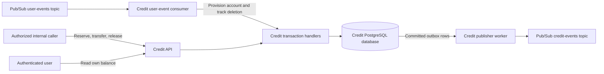
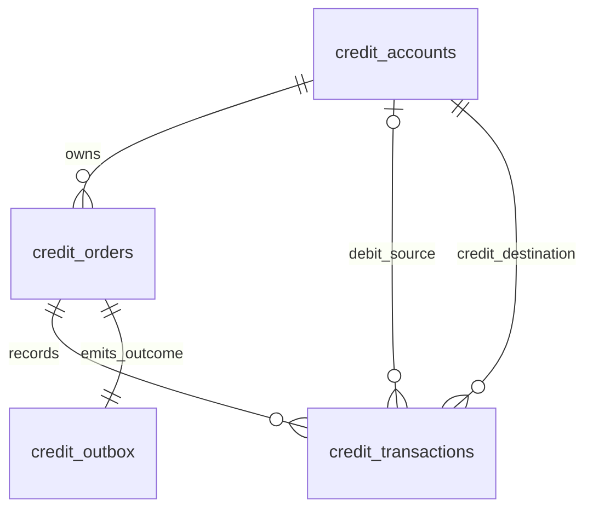
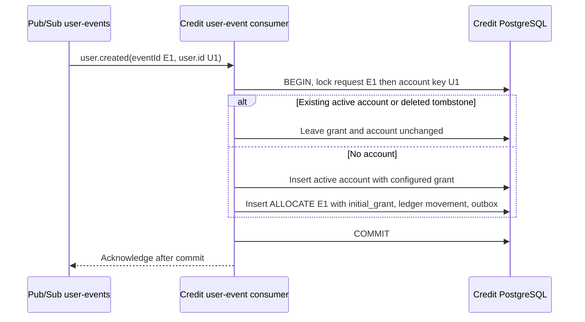

<!-- AI Assistance Disclosure: ChatGPT (GPT-6), 2026-10-18.
Scope: Apply the agreed four-table model and remove lifecycle, reservation, and event version fields; retain the existing JSON result pending the student’s decision.
Author review: Pending. -->
# Credit Service Technical Design

Draft for D3, updated 18 October 2026. Companion: [Product requirements](credit-service-prd.md).

Credit executes commands atomically and publishes outbox outcomes after commit. This design covers Credit’s database, API, user-event consumer, publisher, tests, and container setup. The orchestrator and changes to other services are deferred; an authenticated test client can exercise Credit independently.

## Architecture



No command queue or persisted PENDING CreditOrder. Outcomes are SUCCEEDED/REJECTED; technical failures roll back for retry. Credit receives explicit internal commands; it does not consume order lifecycle events. Caller blocking behavior does not change execution.

User IDs are positive INTEGER values supplied by User Service; do not generate new user IDs in Credit. Errand order IDs remain UUIDs. Public JSON uses `orderId` for the errand and `requestId` for the CreditOrder. These are external references, not cross-service foreign keys. Retain history through profile changes; never reuse user IDs. Follow the team runtime/framework.

## Database and schema

Use PostgreSQL for atomic two-account transfers, row locking, and constraints. Credit has four tables: credit_accounts, credit_orders, credit_transactions, and credit_outbox. Account balances and deletion state are mutable; finalized CreditOrders, ledger transactions, and outbox payloads are immutable. Only the outbox publication timestamp changes.

### Database ERD



### Credit accounts

One row per User Service user ID holds current balances and lifecycle state. user_id alone is the primary key; there is no separate account_id. AVAILABLE and RESERVED are logical buckets, not separate physical account rows. Derive available_credits = total_credits - reserved_credits.

| Column | Type and constraint | Meaning |
|---|---|---|
| `user_id` | INTEGER primary key, check > 0 | Existing User Service identity |
| `total_credits` | BIGINT, not null, check >= 0 | All credits owned, including reserved credits |
| `reserved_credits` | BIGINT, not null, check >= 0 and <= total | Credits held for unsettled errands |
| `deleted_at` | Nullable TIMESTAMPTZ | Permanent deletion tombstone |
| `created_at`, `updated_at` | TIMESTAMPTZ, not null | Local account record timestamps |

A deletion received before creation inserts a zero-total, zero-reserved account with deleted_at set and no allocation. It is an inactive tombstone, not a provisioned active account. A later creation cannot activate or grant to it. Deletion of a provisioned account preserves its balances and all history. A missing row means ACCOUNT_PENDING; a deleted row means USER_INACTIVE. Active account creation and allocation always commit together.

No user lifecycle counter is stored. This depends on User Service never reusing IDs and Credit never clearing deleted_at or supporting undelete. Repeated deletion preserves the original local deletion timestamp. Profile updates are ignored and cannot reactivate accounts. Store no names, emails, roles, or password hashes.

Use JSON numbers for all monetary fields in commands, responses, and events. Reserve/release command amounts are whole integers from 1 to 2,147,483,647, matching Order’s creditReward limit. Balances and positive INITIAL_CREDITS stay within Number.MAX_SAFE_INTEGER (9,007,199,254,740,991).

Keep PostgreSQL BIGINT storage with upper-bound checks on balances, initial grants, and movement amounts. Read BIGINT exactly as strings or bigint internally, validate bounds, and only then convert to JSON numbers. Before transfer, check amount <= MAX_SAFE_INTEGER - courier.total_credits under account locks. Failure records a definitive 409 BALANCE_LIMIT_EXCEEDED rejection without moving credits.

### Credit orders

One immutable row per finalized command, not one mutable row per errand. Command callers reuse request_id on retry. ALLOCATE uses the source user.created eventId as request_id and correlation_id.

| Column | Type and constraint | Meaning |
|---|---|---|
| `request_id` | UUID primary key | Stable command ID, or source creation eventId |
| `kind` | Text enum: ALLOCATE, RESERVE, TRANSFER, RELEASE | Requested action |
| `initial_grant` | Nullable BIGINT, check > 0 and <= MAX_SAFE_INTEGER when present | Actual grant issued; required only for ALLOCATE |
| `request_payload` | JSONB, not null | Canonical validated business fields for retry comparison |
| `order_id` | Nullable UUID | External errand ID; required except for ALLOCATE |
| `user_id` | INTEGER, not null, local account foreign key | Grant recipient or errand requester |
| `status` | Text enum: SUCCEEDED, REJECTED | Final command outcome, distinct from derived errand state |
| `result` | JSONB, not null | Existing saved result: original HTTP status/code, applied flag, deltas, linked transaction IDs, and state at execution |
| `correlation_id` | UUID, not null | Caller workflow or source event correlation |
| `created_at` | TIMESTAMPTZ, not null | Local finalization timestamp |

Keep the existing JSON result representation. Replacing it with structured outcome fields remains undecided and is not part of this revision. Replays return the saved result; they do not rerun a rejected or successful command against current balances. A saved reservationState is a historical snapshot, not mutable current state.

Index (order_id, kind, status) for per-errand history. Enforce one successful ALLOCATE per user. Add a unique constraint/index for each balance-changing (order_id, kind), filtered to SUCCEEDED with result.applied=true. Matching fresh-ID repeats remain successful no-ops with applied=false; they create no movement. Every writer also takes the common per-order lock so TRANSFER and RELEASE cannot both settle an errand. Cancellation has applied=false because it changes no balance, but its successful RELEASE record still blocks later reservation.

The original reserve is found by order_id through a successful RESERVE linked to its actual ledger movement. There is no original-request column or separate current-state record.

### Credit transactions

One immutable successful movement linked to its CreditOrder. Rejections, repeats, and cancellation before reserve have no movement. No pending/failed movement rows or execution-status column.

| Column | Type and constraint | Meaning |
|---|---|---|
| `transaction_id` | UUID primary key | Committed movement identity |
| `credit_order_request_id` | UUID, not null, foreign key to credit_orders | Parent command |
| `debit_user_id` | Nullable INTEGER, local account foreign key | Source user; null only for issuance |
| `credit_user_id` | INTEGER, not null, local account foreign key | Destination user |
| `debit_bucket`, `credit_bucket` | Text enum: AVAILABLE, RESERVED, ISSUANCE | Source and destination buckets |
| `amount` | BIGINT, not null, check > 0 | Whole credits moved |
| `created_at` | TIMESTAMPTZ, not null | Movement timestamp |

| Kind | Source | Destination |
|---|---|---|
| ALLOCATE | Logical system ISSUANCE | New user AVAILABLE |
| RESERVE | Requester AVAILABLE | Same requester RESERVED |
| RELEASE | Requester RESERVED | Same requester AVAILABLE |
| TRANSFER | Requester RESERVED | Courier AVAILABLE |

Only allocation increases supply. RELEASE does not reverse a completed TRANSFER. Current balance-changing actions each produce one movement. Linkages and request fields must agree with the ledger users and amount.

### Credit outbox

One outcome per finalized CreditOrder, committed with its effects and published afterward. Only published_at changes. Read event type from payload.type. Log publication errors with event/request IDs; no event_type, attempts, or last_error columns are stored.

| Column | Type and constraint | Meaning |
|---|---|---|
| `event_id` | UUID primary key | Stable logical event identity across deliveries |
| `request_id` | UUID, not null, unique, foreign key to credit_orders | One outcome per finalized command |
| `payload` | JSONB, not null | Complete immutable envelope |
| `created_at` | TIMESTAMPTZ, not null | Time persisted |
| `published_at` | Nullable TIMESTAMPTZ | Broker publication acknowledged |

Index unpublished rows. Retain CreditOrders and movements for the errand/retry lifetime: they are both the command history and the source of current credit state. Never discard the successful RELEASE record that prevents a late reserve. Published outbox rows may be archived after the recovery window; state lookup must not depend on their retention.

## Derived errand state

There is no reservation table and no stored reservation counter. A shared read function derives current credit state from CreditOrders and their linked movements for one order_id. Only SUCCEEDED commands affect state; rejected attempts are ignored.

| Committed evidence for the errand | Derived state |
|---|---|
| No reserve movement and no successful RELEASE | NONE |
| Reserve movement, no successful RELEASE or transfer movement | HELD |
| Reserve movement and a successful RELEASE | RELEASED |
| Successful RELEASE without any reserve movement | CANCELLED |
| Transfer movement | TRANSFERRED |

Find reserve/transfer evidence through the ledger joined to its successful parent command. This excludes fresh-ID no-ops without relying on timestamps or replaying balance changes. A successful RELEASE counts even without a movement, so cancellation remains visible. A transfer and a successful release for the same errand violate the state rules and must not be treated as a normal history.

For HELD, derive requester and amount from the actual reserve movement. For TRANSFERRED, derive the paid courier from the transfer movement. For CANCELLED, derive requester and amount from the successful RELEASE request_payload. Matching repeats must agree with those facts. State lookup returns current state, participants, and amount; saved command results retain their own historical snapshots.

| Current derived state | New RESERVE | New RELEASE | New TRANSFER |
|---|---|---|---|
| NONE | Reserve if eligible | Record CANCELLED without movement | Retryable RESERVATION_NOT_READY |
| HELD | Matching request is a no-op | Release the held amount | Pay the courier |
| RELEASED | Reject; cannot reopen | Matching request is a no-op | Reject |
| CANCELLED | Reject RESERVATION_CANCELLED | Matching request is a no-op | Reject RESERVATION_CANCELLED |
| TRANSFERRED | Reject; cannot reopen | Reject | Matching courier is a no-op |

This table applies after request replay and participant checks. A successful reserve followed by release derives RELEASED. A successful release before reserve derives CANCELLED, and the later reserve is rejected. Both arrival orders serialize on the same order_id, even when no history exists.

## Execution and idempotency

### Shared command transaction

1. Authenticate/authorize the caller and validate inputs. No command or balance read provisions an account.
2. Begin transaction and take a transaction-scoped request_id lock. Return the saved result for a matching finalized request. Changed kind/business fields return IDEMPOTENCY_CONFLICT without another command or event.
3. Take a transaction-scoped order_id lock even if no CreditOrder exists yet. Read the committed command/movement history and derive state. All command handlers share this locking scheme.
4. Resolve participants from the history and input, then lock user/account keys in sorted user-ID order, including missing accounts. The user-event consumer uses the same per-user lock. Global lock order is request → errand → account.
5. Require active accounts for new reserve/transfer. Deleted participants return 403 USER_INACTIVE; missing accounts return retryable 503 ACCOUNT_PENDING. These failures finalize no command. RELEASE permits a deleted account only if an allocation exists, allowing existing obligations to close. A deleted pre-provisioning tombstone returns USER_INACTIVE; an absent requester returns ACCOUNT_PENDING. Same-ID replays were already handled in step 2.
6. Validate state, requester, courier, amount, available balance, and recipient limits. Apply any movement and insert the finalized CreditOrder, ledger entry, and outbox outcome in the same transaction. Definitive business rejection records REJECTED without a movement; successful repeats and cancellation record SUCCEEDED without a movement.
7. Commit before responding or publishing. Technical failure rolls back all command writes; retry with the same requestId.

Compare canonical kind, orderId, requester, amount, courier, and reason as applicable; ignore retry metadata. Transfer compares only caller-supplied orderId/courierId and derives requester/amount internally. Keep correlation stable. Per-request locking protects identical retries; per-errand history protects retries with fresh IDs; account locking prevents overspending across different errands. SQL uniqueness constraints back up the single-grant and single-movement rules.

### Shared movement logic

Business-specific reserve/release/transfer handlers share an internal movement operation. It updates buckets and inserts ledger evidence using the existing transaction, never commits independently, and is not a public generic-transfer API.

| Movement | Requester total | Requester reserved | Courier total |
|---|---:|---:|---:|
| Reserve A | Unchanged | +A | Unchanged |
| Release held A | Unchanged | -A | Unchanged |
| Cancel before reserve | Unchanged | Unchanged | Unchanged |
| Transfer A | -A | -A | +A |

Reserved credits equal the sum of actual reserve amounts whose derived state is HELD. Balances remain nonnegative and reserved <= total. Terminal states never reopen. Do not recompute current balances by executing historical commands; accounts hold current balances while history explains their movements.

### Provisioning and permanent deletion

Credit owns a durable credit-service-user-events subscription to user-events, separate from other services’ subscriptions. Authenticate Pub/Sub push delivery and validate eventId, type, and positive user ID from user.id for creation or userId for deletion. The existing upstream envelope may include version; ignore it in Credit. Do not store or emit version fields, and do not change the User Service contract.



Account creation, ALLOCATE with the actual initial_grant, issuance movement, and outbox event commit atomically. Repeated creation, including different eventIds for one user, creates no additional grant, CreditOrder, or event. Configuration changes affect new accounts only. Allocation outcome eventId is distinct from the source requestId.

For user.deleted, take the same account-key lock. Set deleted_at if not already set. If no row exists, insert a zero-balance deleted account without an ALLOCATE order or movement. Never clear deleted_at. Creation after deletion is always ignored, regardless of delivery order or upstream counters. If creation committed first, deletion retains its grant and financial history; it does not reverse issued credits. user.updated is acknowledged without changing Credit data.

These rules replace lifecycle counters because account creation is one-time and deletion is irreversible. They do not support undelete or ID reuse. Concurrent creation/deletion serialize by user ID. Duplicate deletion changes nothing. Acknowledge after commit; transient processing/database failure returns an error for Pub/Sub retry.

Create the subscription before registration traffic and before backfill. Existing users need retained creation-event replay or a trusted current-user export through a Credit-owned offline tool invoking the same handler with stable source IDs. The importer never clears deletion tombstones. No public arbitrary-user allocation endpoint is provided.

### Release before reserve

With no successful reserve or release history and a provisioned requester, RELEASE stores a successful CreditOrder containing the validated requester/amount and result.reservationState=CANCELLED. It also stores an outbox event. It creates no reservation row or ledger movement and changes no balance. result.applied=false describes the absence of a financial movement, not the absence of a cancellation guard.

```mermaid
sequenceDiagram
    participant S as Authorized caller
    participant C as Credit Service
    participant D as Credit PostgreSQL
    S->>C: RELEASE R2, O1, requester U1, amount 120
    C->>D: BEGIN, request lock R2, errand lock O1, account lock U1
    D-->>C: No reserve/release evidence; account provisioned
    C->>D: Save successful RELEASE with CANCELLED result and outbox, no movement
    C->>D: COMMIT
    C-->>S: Successful cancellation
    S->>C: Delayed RESERVE R1, O1, requester U1, amount 120
    C->>D: BEGIN, request lock R1, errand lock O1
    D-->>C: Successful RELEASE, no reserve movement: CANCELLED
    C->>D: Validate participant and save REJECTED R1 plus outbox, COMMIT
    C-->>S: 409 RESERVATION_CANCELLED
```

If reserve acquires the errand lock first, its committed movement establishes HELD and release then frees it. If release acquires the lock first, its successful history blocks reserve. A matching fresh-ID release in RELEASED/CANCELLED saves a no-op result without another movement. Original commands remain immutable. Credit does not independently expire holds; callers request release for cancellation or expiry.

## APIs and access control

Proposed routes require authenticated, allowlisted internal callers. Public balance access is owner-only; no browser mutations. Saga/Order authorizes lifecycle/assignment; Credit validates identities, hold, amount, and self-transfer.

For balance reads, verify end-user bearer JWTs locally with the shared `JWT_SECRET`: HS256 signature, JWT header, expiry, and a positive integer user ID encoded as the string `sub`. Derive the account owner from `sub`, not an arbitrary supplied user ID. Check the account’s deleted_at and existence: a deleted user receives 401, and missing provisioning receives retryable 503 ACCOUNT_PENDING. JWT validation does not create accounts. As with Order’s projection, deletion takes effect when its event is applied locally.

Internal commands and Pub/Sub pushes use Google OIDC with the configured audience and service-account email allowlist, or the shared secret for the local emulator (`x-internal-secret`, or the push URL’s `token` parameter as Order does). Restrict the user-event endpoint to the configured Pub/Sub delivery identity in Cloud. A user JWT alone never authorizes event ingestion or reserve/transfer/release commands. No synchronous User Service lookup is needed for provisioning or participant validation. Operation lookup is available to explicitly authorized internal callers; it is not restricted to the originating service. Network ingress restrictions do not establish ownership of an individual operation. No originating-service column is required.

| Method and route | Caller | Payload or result |
|---|---|---|
| `POST /internal/pubsub/user-events` | Authenticated Pub/Sub push | Existing user-event envelope inside the standard Pub/Sub push wrapper; creation provisions, deletion disables, updates are ignored |
| `GET /api/v1/credits/me` | Authenticated account owner | `totalCredits`, `reservedCredits`, `availableCredits` |
| `POST /internal/v1/credit-reservations` | Orchestrator | `requestId`, `correlationId`, `orderId`, `requesterId`, `amount` |
| `POST /internal/v1/credit-reservations/{orderId}/transfer` | Orchestrator | `requestId`, `correlationId`, `courierId`; requester and amount come from successful reserve history |
| `POST /internal/v1/credit-reservations/{orderId}/release` | Orchestrator | `requestId`, `correlationId`, `requesterId`, `amount`, `reason` |
| `GET /internal/v1/credit-orders/{requestId}` | Authorized internal caller | Existing committed CreditOrder and result; `404` if absent |
| `GET /internal/v1/credit-reservations/{orderId}` | Orchestrator | Derived current state, participants, and amount from command/movement history; no reservation table |
| `GET /health/live`, `GET /health/ready` | Deployment checks | Process health; database readiness respectively |

HTTP: 200 committed action/replay and successfully processed Pub/Sub push; 400 invalid input; 401/403 identity/access failure; 409 insufficient balance/state/idempotency conflict; 503 ACCOUNT_PENDING for missing provisioning or temporary dependency/not-ready failure; 404 for absent operation/reservation lookup. Invalid/unauthorized requests create no order. Persist definitive business rejections and original response status; retryable failures have no completed order.

Reserve example:

```json
{
  "requestId": "6f1c3fc6-183c-4c56-99f9-d6df888ee944",
  "correlationId": "a7a461f2-e5fa-4a30-9699-f834737f38e5",
  "orderId": "4c29bc32-b0ef-4ab4-91dd-0bd579bb9ac8",
  "requesterId": 1,
  "amount": 120
}
```

Result: requestId, status, transactionIds, code, orderId, reservationState, applied deltas. Keep the existing saved JSON result for now. Snapshots reflect execution time; query current balances separately.

## Events and delivery

Publish to the Google Pub/Sub `credit-events` topic. Follow Order’s shared field mapping: `eventId`, `type`, `orderId`, and `occurredAt`. Publish `type` and, for reservation actions, `orderId` as string message attributes for subscription filters. Allocation has no errand: omit `orderId` from the envelope and attributes. Credit-specific fields (`requestId`, `correlationId`, and `data`) carry the credit result; do not fabricate an Order snapshot or Order event sequence.

| Outcome | `type` |
|---|---|
| Initial allocation | `credit.account_allocated` |
| Reservation applied | `credit.reserved` |
| Reservation rejected | `credit.reservation_rejected` |
| Transfer applied | `credit.transferred` |
| Release applied | `credit.released` |
| Other definitive rejection | `credit.order_rejected` |
| Successful no-op | `credit.order_succeeded` |

Fresh-ID no-ops set `applied=false`, zero deltas, and current state. Cancellation before reserve uses credit.order_succeeded with applied=false and reservationState=CANCELLED. Same-ID replays create no new event. Event snapshots can arrive late; consumers correlate by requestId and use state lookup to resolve stale or conflicting outcomes rather than treating delivery order as current state.

```json
{
  "eventId": "77d6e2ca-ef0e-4385-8a17-cdb4a6b15c18",
  "type": "credit.reserved",
  "occurredAt": "2026-10-12T09:00:00Z",
  "requestId": "6f1c3fc6-183c-4c56-99f9-d6df888ee944",
  "correlationId": "a7a461f2-e5fa-4a30-9699-f834737f38e5",
  "orderId": "4c29bc32-b0ef-4ab4-91dd-0bd579bb9ac8",
  "data": {
    "requesterId": 1,
    "amount": 120,
    "status": "SUCCEEDED",
    "reservationState": "HELD",
    "transactionIds": ["5324a610-a832-4b47-83dc-a0645ce447a8"],
    "applied": true
  }
}
```

Include courier for transfer, reason code for rejection; omit tokens/names/addresses/delivery details. Deduplicate by eventId, correlate by requestId, guard settlement using locked per-errand history. Task-only deduplication suppresses distinct actions.

### Outbox delivery and recovery

Start one publisher. Read committed unpublished outbox rows and publish their stored envelopes to Pub/Sub. Use `orderId` as the ordering key for reservation actions and the integer user ID encoded as a string for allocation. Enable message ordering, as Order’s publisher does. After publication is acknowledged, mark the row published. A crash between acknowledgement and marking may repeat delivery with the same `eventId`.

On publication failure, retain the row and retry; resume a failed Pub/Sub ordering key before retrying. Do not publish later outcomes for the same key ahead of the failed outcome. A broker outage does not roll back committed credit effects or make the API unready.

Consumers must deduplicate by `eventId`. Consumers of credit outcomes and saga advancement are outside this implementation; the user-event consumer belongs to Credit. Credit exposes operation and reservation lookup so callers can recover uncertain results independently of event delivery.

| Failure | Credit behavior |
|---|---|
| Commit succeeds; HTTP response lost | Same-ID retry or lookup returns the committed result. |
| Broker unavailable after commit | Retain the outbox row and retry publication. |
| Publisher crashes after publication | Republish the stored envelope with the same eventId. |
| Transfer races release | The shared errand lock and committed command history permit only one terminal settlement. |
| TRANSFER arrives before RESERVE | Return retryable RESERVATION_NOT_READY. |
| RELEASE arrives before RESERVE | Atomically save successful RELEASE history with CANCELLED result and outbox outcome; reject a later reserve without moving credits. |

Release cannot reverse a completed transfer; refunds are outside current scope.

## Deployment and verification

Follow Order’s Node.js 22, TypeScript ESM, Express, Drizzle, and pg conventions and multi-stage image. The API hosts the authenticated user-event push endpoint; the publisher uses the same image with a distinct startup command. Add Credit’s isolated PostgreSQL database, migration job, and named volume to Compose; reuse the existing Pub/Sub emulator. Only Credit writes its schema. Use the existing `@google-cloud/pubsub` client and emulator configuration; no Redis service is needed.

Supply `DATABASE_URL`, `INITIAL_CREDITS`, `PORT`, `JWT_SECRET`, `INTERNAL_AUDIENCE`, `INTERNAL_INVOKER_EMAILS`, and the local-only `INTERNAL_SHARED_SECRET` through environment/secrets. Use `PUBSUB_PROJECT_ID`, `PUBSUB_EMULATOR_HOST` locally, `PUBSUB_PUSH_BASE_URL`, `USER_EVENTS_TOPIC` (default `user-events`), `USER_EVENTS_SUBSCRIPTION` (default `credit-service-user-events`), and `CREDIT_EVENTS_TOPIC` (default `credit-events`). Commit placeholders only. Migrate and create the durable user-event subscription before registration traffic; demo users are provisioned through user events. Keep the subscription across restarts, configure retries/dead-letter monitoring, and repair failed events before retention expires. Local emulator delivery is for development; it is not the recovery store for existing users. Volumes survive restart/recreation; deleting volumes deletes data.

Health checks plus bounded runtime retries handle startup/outages. API readiness needs the database, not broker availability: outbox retains events. Publisher health needs both. Graceful shutdown commits or rolls back current work; unpublished rows survive.

Build schema/atomic handlers, then APIs/publisher/Compose. Use real PostgreSQL integration tests:

1. Concurrent/redelivered creation, including different eventIds for one user, commits one account, ALLOCATE, movement, and outbox outcome. Profile updates arriving first never suppress allocation.
2. Creation then deletion retains balances/history and blocks new use. Deletion then creation retains a zero-balance tombstone and never allocates. Repeated deletion preserves deleted_at. No counters, undelete, or ID reuse are used.
3. Two concurrent 700-credit reserves against 1,000 permit one movement. Same-ID success/rejection replays the saved result even after balances/state change; changed payload conflicts.
4. Fresh-ID reserve/transfer/release repeats create no duplicate movements. Deriving state ignores rejected commands and distinguishes successful no-ops from actual reserve/transfer movements.
5. Test NONE, HELD, RELEASED, CANCELLED, and TRANSFERRED derivation. CANCELLED survives solely through successful RELEASE history with no movement. It remains effective after published outbox rows are archived.
6. Test both serialized outcomes of concurrent reserve/release and transfer/release. There is no separate row to lock for reservation state: every handler must take the errand-key lock before reading history.
7. Failure between debit and credit rolls back balances, CreditOrder, movement, and outbox. Provisioning failure rolls back the account, allocation, issuance movement, and event together.
8. Transfer-before-reserve is retryable. Transfer/reserve after cancellation is definitive rejection. Deleted allocated accounts can have existing holds released; tombstone-only accounts cannot create commands claiming a grant exists.
9. Assert ledger/balance agreement, nonnegative balances, HELD sums, and supply conservation. Histories may not contain both transfer and successful release for one errand.
10. Broker outage/restart eventually publishes; publish-before-mark crash repeats the same eventId. Payloads contain no schemaVersion or reservationVersion; existing upstream user events with extra version metadata remain accepted.
11. Before provisioning, balance/reserve/transfer return ACCOUNT_PENDING without creating an account or finalized command. Retrying after the creation event works. Backfill/live traffic cannot regrant or reactivate deleted accounts.
12. Reject forged event pushes, unauthorized reads/mutations, self-transfer, invalid amounts, and conflicting participants. Internal lookup admits configured callers without requiring the originating service.
13. Verify amount boundaries and exact JSON-number balance output; recipient overflow rejects atomically. Container restart preserves data. A test client drives all operations without an orchestrator.

D3: show balances, API results, order/ledger rows, duplicate command, and interrupted dependency. Log request/transaction/event/task/correlation IDs, outcome, and retry reason, never credentials. Inspect unpublished event age and logged worker errors; no separate dashboard.

## Remaining decisions

| Question | What remains open |
|---|---|
| Can a rejected pending errand try again after its balance changes? | Same requestId replays rejection. A new request is a new attempt, but errand eligibility is the order owner's policy. |
| What are the reversal limits? | Core RELEASE releases the full hold. Partial release or reversing a completed transfer would need additional policy; neither is assumed. |
| What remains for initial allocation? | Confirm the grant amount and prepare existing-user backfill. Authenticated user.created delivery is the provisioning source; Credit owns retries through its durable subscription. |
| What remains to confirm in the Credit contract? | Route approval, internal caller permissions, and whether to replace the existing JSON result with structured outcome fields. Keep result until that decision is made. Whole-credit JSON numbers and safe-integer balance bounds are selected. Integer user IDs, UUID errand/request IDs, Pub/Sub, and Order-style event field mapping are selected. |

CANCELLED is derived from a successful RELEASE with no reserve movement; no reservation record is needed. Other services and their recovery workflows are outside this implementation.
